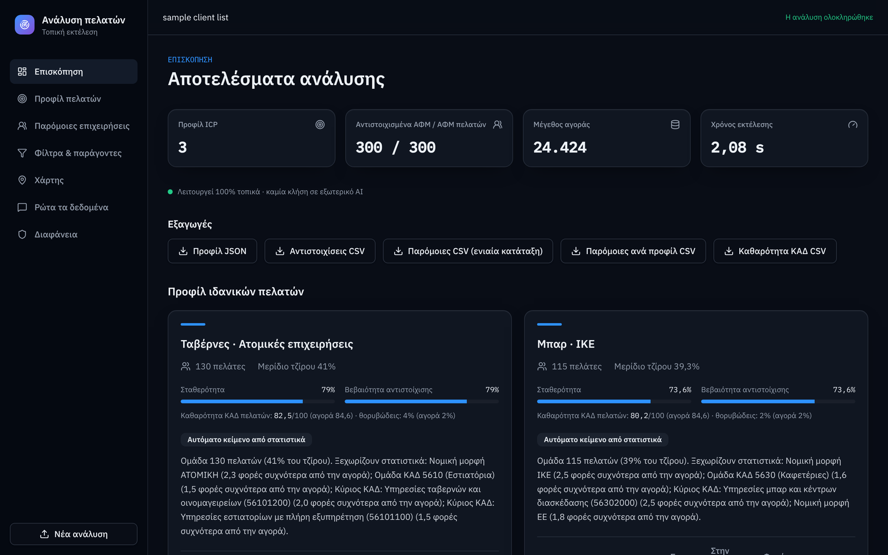
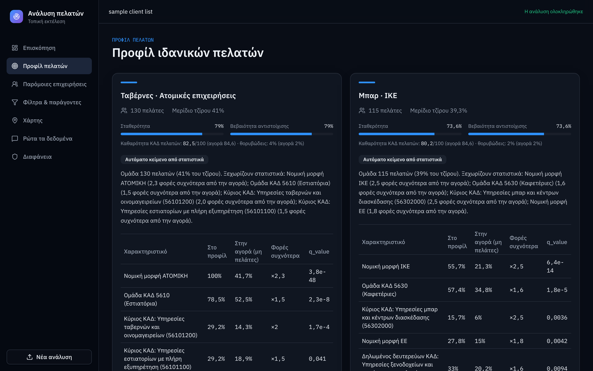
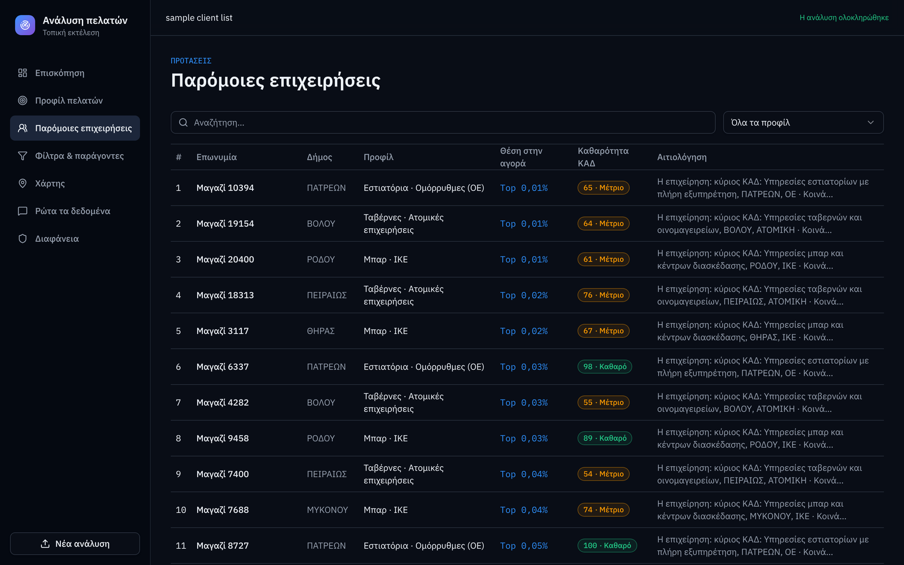
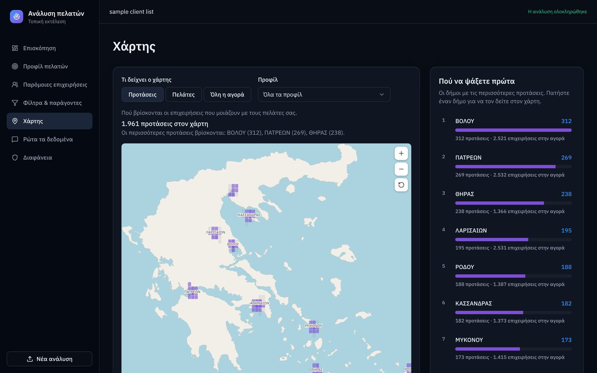
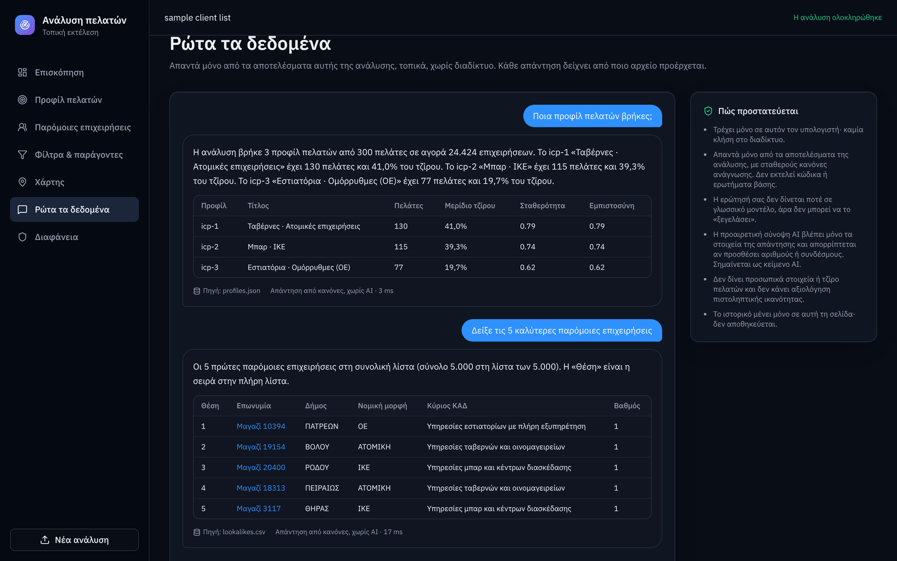
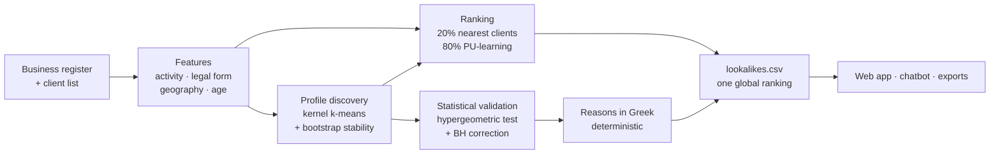

<div align="center">

# Lookalike Finder

**Find your next best customers. Explainable, local, and fast.**

Upload a client list → discover who your ideal customers really are → get a ranked list of look-alike businesses, each with a plain-language reason. Everything runs on your own machine.




*Screenshots use synthetic demo data. The real competition data is confidential and is not part of this repository.*

</div>

---

## Why this exists

A sales team has a few hundred known customers and a market of tens of thousands of businesses. Which ones should they call first? Most tools hand back a black-box list. This project:

1. **Learns who your customers are.** It discovers 1–6 *ideal customer profiles* (ICPs) from the client list, statistically validates each one, and checks that they are stable.
2. **Ranks the whole market.** Every business gets a similarity rank against those profiles.
3. **Explains every suggestion.** Each result carries a reason in Greek: what it has in common with your customers, and where it differs.
4. **Keeps your data at home.** No cloud calls, no third-party APIs. It works with the network cable unplugged.

It was built in a few days for a university open-innovation hackathon on the Greek business register (≈24k food-service businesses, 300 known clients).

## Results

Measured end to end on the real competition data: hide 20% of the clients, run the **production pipeline** on the rest, and check how many hidden clients land in the top *k* of `lookalikes.csv` (Recall@k). Average of 10 random splits, 95% confidence intervals.

| | Recall@500 | Recall@2000 |
|---|---|---|
| **This project** | **15.3% ± 2.6** | **55.2% ± 1.6** |
| Baseline: same main business activity code, ordered by how common it is among clients | 2.0% ± 1.2 | 7.5% ± 1.2 |

That is about **8× better at k = 500** and **7× better at k = 2000**. An ablation on the same data shows each ingredient matters (Recall@2000: activity only 22.5%, without geography 29.4%, full method 54.4%, earlier 5-split run).

> **Honest caveat.** The method's weights were tuned on the same 300 clients, so expect the number on unseen data to be somewhat lower. Eleven alternative ranking schemes were tried; none beat this one beyond noise, so the simplest was kept. Details in [`docs/MODEL_DATA_CARD.md`](docs/MODEL_DATA_CARD.md).

| Speed | |
|---|---|
| Full analysis of 24,424 businesses | **≈ 2–3 s** on a laptop CPU |
| Scaling | linear in the number of businesses (no pairwise N² step) |
| Reproducibility | identical output on every run, checked with `python run.py consistency` |

## Screenshots

| Ideal-customer profiles, validated and explained | Look-alike list with reasons |
|---|---|
|  |  |

| Where to look first (map) | Ask the data (safe chatbot) |
|---|---|
|  |  |

## How it works



- **Similarity.** A weighted blend of cosine similarities over business-activity text (TF-IDF + SVD, no neural network, no download), legal form, multi-scale geography, company age and administrative area.
- **Profiles.** Weighted kernel k-means on that same similarity, with *k* chosen by bootstrap stability. If no stable split exists it honestly returns "one profile".
- **Ranking.** 20% nearest-client similarity plus 80% positive-unlabelled learning (clients are positives, the rest of the market is unlabelled), merged across profiles in proportion to each profile's weight.
- **Validation.** Every profile trait gets a one-sided hypergeometric (Fisher-equivalent) test with Benjamini–Hochberg correction, shrunk lift and minimum support.
- **Optional local AI text.** A small language model (EuroLLM-9B via Ollama) can write the profile descriptions. Its output is checked automatically for invented numbers and forbidden language, and always labelled as AI-generated. Without it, the app uses an automatic statistics-based text.

## Responsible AI and security

- **EU AI Act.** The system groups businesses for B2B sales; it does **not** produce creditworthiness scores or profile natural persons. Self-assessment in [`docs/AI_ACT_SELF_ASSESSMENT.md`](docs/AI_ACT_SELF_ASSESSMENT.md).
- **Local only.** No external API at runtime. The server accepts requests from localhost only.
- **A chatbot that cannot be talked into anything.** "Ask the data" answers from the computed results with fixed rules. The question is never sent to a language model, there is no SQL, code or network access, and it refuses requests about creditworthiness, personal data, individual client turnover, reputation or honesty judgements of businesses, and prompt-injection attempts (including disguised ones). Red-team results: [`docs/SECURITY_TESTS.md`](docs/SECURITY_TESTS.md).
- **Transparent.** Model and data card, known limitations and every design decision are written down in [`docs/`](docs).

## Quick start

You need Python 3.12. The real competition data is not included, so the quickest way to try it is with **synthetic data** that has the same structure:

```bash
git clone https://github.com/Anasteiro/dinnovation-lookalike-finder.git
cd dinnovation-lookalike-finder

python -m venv .venv
source .venv/bin/activate          # Windows: .venv\Scripts\activate
pip install -r requirements-light.txt

python run.py synth --out data      # synthetic demo data (never real)
python run.py serve --data data     # opens http://localhost:8000
```

In the browser click **«Χρήση δείγματος διαγωνισμού»** (use the sample), or upload your own client file (`.xlsx` / `.csv` with a VAT column and an optional turnover column). The interface is in Greek.

**Windows one-click:** `setup_windows.bat` once, then `start_demo.bat`. **Linux:** `bash setup_linux.sh` then `bash start_demo.sh`.

**Using your own business register:** put `vwHackCompany.csv`, `vwHackActivities.csv`, `vwHackCompanyActivity.csv` and a client file matching `*Pelatologio*.xlsx` in `data/`. The `data/` folder is git-ignored so your data can never be committed by accident.

### Optional: AI-written profile descriptions

Install [Ollama](https://ollama.com/download), then:

```bash
ollama pull hf.co/QuantFactory/EuroLLM-9B-Instruct-GGUF:Q4_K_M
python run.py serve --data data --llm-model hf.co/QuantFactory/EuroLLM-9B-Instruct-GGUF:Q4_K_M
```

## Commands

```bash
python run.py serve --data data            # the web app
python run.py analyze --data data --out outputs   # headless: writes the deliverable files
python run.py evalproduct --data data      # hold-out accuracy of the production pipeline
python run.py consistency --data data      # proves identical output across runs
python run.py redteam --data data          # security report for the chatbot
python run.py check                        # environment self-check
python -m pytest -q                        # 57 backend tests
```

### Output files

| File | Content |
|---|---|
| `profiles.json` | profile id, title, AI-labelled description, client count, turnover share, stability, confidence, traits with lift and p-value |
| `assignments.csv` | `company_id, profile_id, score` for every client |
| `lookalikes.csv` | `profile_id, company_id, rank, score, αιτιολόγηση`: one global ranking, `rank` runs 1…5000 in file order, so "first *k*" and "`rank ≤ k`" are the same |
| `lookalikes_by_profile.csv` | the 2,000 best candidates per profile |

## Project layout

```
backend/      engine and FastAPI service (features, clustering, ranking, chatbot, exports)
frontend/     prebuilt web app (served by the backend)
frontend_src/ React + TypeScript source (cd frontend_src && npm install && npm run build)
scripts/      command implementations (run.py ...)
tests/        backend tests, including a chatbot red-team suite
docs/         model & data card, AI Act self-assessment, security tests, API contract
```

## Tech stack

**Backend:** Python, FastAPI, pandas, NumPy, SciPy, scikit-learn, SQLite · **Frontend:** React, TypeScript, Vite, Tailwind CSS, vitest · **Optional:** Ollama with a local language model.

## Data and licences

- Greek business register: GEMI open data (ODC-BY 1.0). Geocoding © OpenStreetMap contributors (ODbL). Census factors: ELSTAT 2021 (CC0).
- EuroLLM-9B-Instruct: Apache-2.0.
- The competition's client list and company files are confidential and are **not** included.

## AI assistance

This project was developed with AI assistance (Claude). All results in this document were measured by running the code, and the repository contains the scripts to reproduce them.

## Team

**DInnovation** · built for the NKUA «Archimedes» open-innovation competition.
